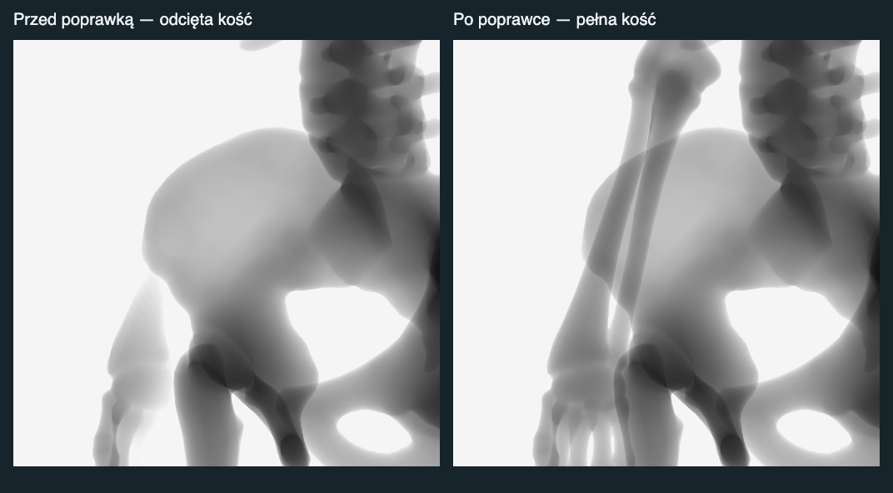

# Zanikanie kości przy przesuwaniu stołu

Zgłoszenie dotyczyło przedramienia przy LAO 50°. Przesunięcie stołu mogło przenieść je poza tylną płaszczyznę kamery, ustawioną na odległość detektora. Pierwsza poprawka zamykała sumę grubości na tej płaszczyźnie, ale całe fragmenty po jej drugiej stronie nadal znikały. Poprzedni test miał takie samo ograniczenie w obrazie odniesienia i nie uznawał tego za błąd.

Projekcja kości otrzymała osobną kamerę z zakresem głębokości dopasowanym do pełnych granic szkieletu. Wszystkie trzy przebiegi anatomii — przednia głębokość, tylna głębokość i suma grubości — używają tej kamery. Pozycja źródła, orientacja, FOV, zoom i współrzędne obrazu są zachowane. Zakres aktualizuje się podczas zmiany projekcji, poza solverem mechaniki. Fizyczna kolizja ramienia z pacjentem nie jest modelowana przez sterowanie stołem; płaszczyzna rasteryzacji nie powinna jej zastępować wycinaniem kości.

Test porównuje teraz wynik z przecięciami promieni z **pełną** geometrią kości przed źródłem. Oddzielnie odtwarza poprzednie odcięcie, dzięki czemu wykazuje rzeczywisty błąd przed zmianą.

| Zestaw GPU | Ustawienia | Rozdzielczość | Sprawdzone piksele kości | Ubytki przed | Ubytki po |
| --- | ---: | --- | ---: | ---: | ---: |
| Odtworzenie LAO 50°, przesunięcie boczne 100 mm | 1 | 512 × 512 | 154 256 | 14 785 | 0 |
| Przesuw stołu w obu kierunkach, trzy poziomy tułowia i trzy wysokości, LAO/RAO 50° | 162 | 96 × 96 | 650 928 | 10 003 | 0 |
| Skrajne kąty i wysokości, pozycje złożone, różne detektory i powiększenia | 377 | 96 × 96 | 1 842 340 | 34 574 | 0 |

Nie stwierdzono ujemnych grubości ani niezamkniętych promieni odniesienia. Największy błąd P95 w całym zestawie: 1,35 mm (bufor half-float). Kryterium ubytku obejmuje wnętrze rzutu o referencyjnej grubości >3 mm wraz z czterema sąsiadami; zanik oznacza wynik GPU <0,1 mm. Subpikselowe krawędzie nie są objęte tym kryterium.

`npm run test:imaging` i `npm run build` zakończyły się powodzeniem. Test kamery obejmuje dodatkowo 1620 kombinacji pozycji, kątów i odległości detektora oraz kamerę z rodzicem w hierarchii sceny. Sprawdza zachowanie współrzędnych X/Y projekcji i niemodyfikowanie kamery źródłowej.

Powtórzenie:

- `http://127.0.0.1:5174/tests/boneCArmLimits.browser.html?suite=table&size=512&case=6&compare=1`
- `http://127.0.0.1:5174/tests/boneCArmLimits.browser.html?suite=table&compare=1`
- `http://127.0.0.1:5174/tests/boneCArmLimits.browser.html?compare=1`

Surowe pomiary: `bone-table-translation-reproduction.json`, `bone-table-translation-sweep.json`, `bone-table-translation-extremes.json`.

